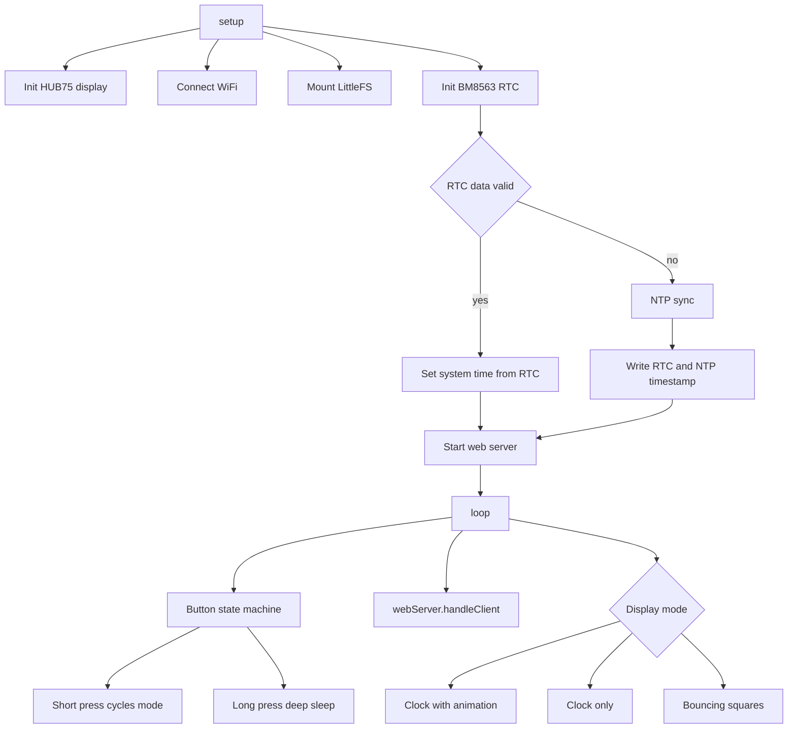

# Assessment: HD-WF1 / HD-WF2 LED Matrix Clock Firmware

## 1. Summary

The sketch is a multi-mode LED matrix clock for the Huidu WF1 (ESP32-S2) and WF2 (ESP32-S3) controller cards. It combines the ESP32-HUB75-MatrixPanel-DMA library, a BM8563 external RTC, NTP, LittleFS, Bounce2, a web server, and a FreeRTOS LED breathing task.

The overall structure is clear and the board-specific pin mapping is well separated. The main risks are concentrated in three areas:

1. The button state machine never re-arms after the first press.
2. The time-source pipeline can block for seconds and can skip timezone setup.
3. The display redraw logic erases or leaks state between modes.

## 2. Architecture

## 3. Strengths

- Board abstraction is clean: [`hd-wf1-esp32s2-config.h`](../src/hd-wf1-esp32s2-config.h:1) and [`hd-wf2-esp32s3-config.h`](../src/hd-wf2-esp32s3-config.h:1) keep pin maps out of the main sketch.
- Sensible library choices: DMA panel driver, Bounce2, LittleFS, BM8563.
- The intent to validate RTC data and fall back to NTP is good.
- Deep sleep support and a multi-mode UI are already present.
- The DMA configuration is reasonable for a 64x32 panel.

## 4. Critical Issues

| ID | Issue | Location | Impact | Fix |
|----|-------|----------|--------|-----|
| C1 | Button state machine never re-arms. `buttonPressHandled` is set to `true` on release and never reset on the next press, so the button works only once. | [`loop()`](../src/HD-WF1-WF2-LED-MatrixPanel-DMA.ino.cpp:566) | Short/long press stops working after the first cycle. | Reset `buttonPressHandled = false` on `button.pressed()`, then handle hold and release. |
| C2 | `getLocalTime()` blocks up to its default 5 s timeout when the system clock is not yet valid. | [`getTimeWithFallback()`](../src/HD-WF1-WF2-LED-MatrixPanel-DMA.ino.cpp:246) | Animation freezes for ~5 s per update when NTP was skipped. | Seed the system clock from the RTC at boot and use `getLocalTime(&tm, 0)` for non-blocking reads. |
| C3 | Timezone is only configured inside the NTP branch. If NTP is skipped, `TZ` stays UTC and the RTC local time is displayed as UTC. | [`configTime()`](../src/HD-WF1-WF2-LED-MatrixPanel-DMA.ino.cpp:461) | Wrong local time after a warm boot with a valid RTC. | Always call `configTzTime()` at boot; store UTC in the RTC and convert for display. |
| C4 | Bouncing-squares mode clears the screen every frame, then draws the clock overlay only once per second. | [`updateBouncingSquares()`](../src/HD-WF1-WF2-LED-MatrixPanel-DMA.ino.cpp:137), [`updateClockOverlay()`](../src/HD-WF1-WF2-LED-MatrixPanel-DMA.ino.cpp:721) | The clock overlay is visible for one frame per second. | Redraw the overlay every frame using a cached time string, or composite into a framebuffer. |
| C5 | Text color is not reset on the success path after an error path sets it to red. | [`updateClockWithAnimation()`](../src/HD-WF1-WF2-LED-MatrixPanel-DMA.ino.cpp:637) | Time stays red after a single time-read failure. | Set the text color explicitly on every draw. |
| C6 | The IP address is printed and then cleared before the delay. | [`setup()`](../src/HD-WF1-WF2-LED-MatrixPanel-DMA.ino.cpp:549) | The IP is never visible. | Delay first, then clear. |
| C7 | Day-of-week is drawn at `y = 26` with an 8 px font on a 32 px panel. | [`updateClockOnly()`](../src/HD-WF1-WF2-LED-MatrixPanel-DMA.ino.cpp:704) | Bottom two rows are clipped. | Move to `y = 24` or reduce the layout. |
| C8 | WiFi connection loop has no timeout. | [`setup()`](../src/HD-WF1-WF2-LED-MatrixPanel-DMA.ino.cpp:312) | Device hangs forever if WiFi is unavailable, even though the RTC clock could still run. | Add a timeout and continue offline. |
| C9 | Deep sleep does not clean up WiFi, LittleFS, or the display, and a held button can re-trigger sleep after wake. | [`loop()`](../src/HD-WF1-WF2-LED-MatrixPanel-DMA.ino.cpp:574) | Higher sleep current and possible immediate re-sleep. | Clear display, disable WiFi, close LittleFS, and require a release before long-press is armed. |
| C10 | `#define fs LittleFS` shadows the `fs::` namespace used by LittleFS headers. | [`#define fs`](../src/HD-WF1-WF2-LED-MatrixPanel-DMA.ino.cpp:36) | Fragile; any later `fs::FS` use breaks compilation. | Rename the macro or use `LittleFS` directly. |
| C11 | The NTP timestamp file is opened with `create = true` in read mode. | [`setup()`](../src/HD-WF1-WF2-LED-MatrixPanel-DMA.ino.cpp:421) | The missing-file branch is never taken and the log is misleading. | Pass `false` for the create flag. |

## 5. Logic and Robustness Improvements

### Time handling

- Validate day-of-month against month and leap year, and validate `weekDay` range in [`isRTCTimeValid()`](../src/HD-WF1-WF2-LED-MatrixPanel-DMA.ino.cpp:196).
- Use `difftime()` or `llabs()` for 64-bit time differences instead of casting to `long` in [`setup()`](../src/HD-WF1-WF2-LED-MatrixPanel-DMA.ino.cpp:449).
- Store UTC in the BM8563 and convert to local time for display. This avoids a one-hour error across DST changes until the next NTP sync.
- Use a POSIX TZ string for the UK, for example `GMT0BST,M3.5.0/1,M10.5.0`, via `configTzTime()`.
- Cache the last valid `struct tm` so the display can keep running if all time sources fail temporarily.
- `esp32rtc` is set but never used for display. Either use it as the primary non-blocking time source or remove the dependency.

### Display and animation

- Throttle the animation to 30-60 FPS instead of redrawing 2048 pixels every loop iteration in [`updateClockWithAnimation()`](../src/HD-WF1-WF2-LED-MatrixPanel-DMA.ino.cpp:644).
- Make motion time-based rather than frame-based, especially in [`updateBouncingSquares()`](../src/HD-WF1-WF2-LED-MatrixPanel-DMA.ino.cpp:142).
- Enable double buffering and call `flipDMABuffer()` to reduce tearing.
- Use `setTextWrap(false)` and explicit text colors before every `print()`.
- Use `PANEL_RES_X * PANEL_CHAIN` for full-width fills such as [`fillRect()`](../src/HD-WF1-WF2-LED-MatrixPanel-DMA.ino.cpp:629).
- Seed the RNG with `esp_random()` in [`initBouncingSquares()`](../src/HD-WF1-WF2-LED-MatrixPanel-DMA.ino.cpp:125).
- Avoid clearing the whole screen every second in [`updateClockOnly()`](../src/HD-WF1-WF2-LED-MatrixPanel-DMA.ino.cpp:686); redraw only changed regions or use double buffering.
- Consider `mxconfig.min_refresh_rate` and a safer `i2sspeed` such as 16 MHz for panel compatibility.

### Networking and lifecycle

- Call `wifiMulti.run()` periodically in `loop()` to reconnect after a drop.
- Consider `WiFi.setSleep(false)` for a responsive web server.
- Add mDNS (`MDNS.begin("ledclock")`) since `ESPmDNS.h` is already included.
- Check the return values of `new`, `dma_display->begin()`, and `rtc.begin()`.
- Before deep sleep, clear the display, set brightness to 0, call `WiFi.disconnect(true)`, `WiFi.mode(WIFI_OFF)`, and `LittleFS.end()`.
- If the board has no external pull-up on the button, use `INPUT_PULLUP` and enable the RTC pull-up before sleep.

### Code quality

- Remove dead code: [`toggleButtonPressed()`](../src/HD-WF1-WF2-LED-MatrixPanel-DMA.ino.cpp:118), `buttonPressed`, `Task2`, and unused includes such as `HTTPClient.h` and `ESPmDNS.h` if mDNS is not added.
- Add `#pragma once` to [`littlefs_core.h`](../src/littlefs_core.h:1) and mark header-defined functions `inline` to avoid ODR issues.
- Trim unused LittleFS helpers (`make_tm`, `readFile2String`, `setup2`, `testFileIO`) or move them to a `.cpp`.
- Precompute the LEDC maximum duty in [`ledFadeTask()`](../src/led_pwm_handler.h:18) instead of calling `pow()` every iteration.
- Fix the fade timing: `LED_FADE_TIME / 255` is 3 ms, so a full fade takes ~765 ms, not 1000 ms.
- Increase the LED task stack from 1000 to at least 2048 bytes.
- Remove the unused `BREATH_TIME` constant or use it.
- Reduce `CORE_DEBUG_LEVEL` from 5 to 2-3 for normal builds.
- Pin the platform fork and git dependencies to tags or commits in [`platformio.ini`](../platformio.ini:16) for reproducible builds.
- Align the WF2 board definition with the README recommendation (`wifiduino32s3`).
- Move WiFi credentials out of source into a gitignored `secrets.h` or LittleFS config.
- The README claims OTA firmware updates, but ElegantOTA is commented out. Either implement OTA or correct the README.
- Fix the test sketch: `Serial.begin(112500)` should be `115200`, the active-low button interrupt should be `FALLING`, and the ISR should be `IRAM_ATTR`.

## 6. Enhancements

### Enhancement A: Web configuration portal and OTA

Replace the hardcoded WiFi credentials with a small configuration portal and persist settings in LittleFS as JSON.

- Configure WiFi, timezone, brightness, and default display mode from a phone.
- Add ElegantOTA or ArduinoOTA so firmware can be updated over the air.
- Add mDNS so the device is reachable at `ledclock.local`.
- Add a small REST API:
  - `GET /api/status` returns time, mode, brightness, IP, and RSSI.
  - `GET /api/mode?n=2` switches display mode.
  - `GET /api/brightness?v=128` sets brightness.
  - `GET /api/message?text=...` scrolls a message.
- Add a minimal HTML control page served from LittleFS.

This removes the recompile-for-WiFi workflow and makes the device feel like a finished product.

### Enhancement B: Weather display and auto-brightness

Use the Open-Meteo API, which needs no API key, to fetch current weather and sunrise/sunset times.

- Refresh every 15-30 minutes with `HTTPClient` and `ArduinoJson`.
- Add a weather mode or a rotating overlay showing temperature and a simple sun/cloud/rain icon drawn with primitives.
- Use sunrise and sunset to drive `setBrightness8()` with smooth transitions: bright during the day, dim at night.
- Allow a manual brightness override from the web API.

This makes the clock genuinely useful and comfortable to live with at night.

### Bonus idea

A smooth analog clock face or a plasma/starfield effect would add visual polish and show off the panel. It is optional and lower priority than the two enhancements above.

## 7. Proposed Roadmap

### Phase 1: Correctness

- Fix the button state machine.
- Fix the time pipeline: TZ, system clock seeding, non-blocking reads.
- Fix the display bugs: text color, IP visibility, day-of-week clipping, overlay redraw.

### Phase 2: Robustness

- Add WiFi timeout and reconnect.
- Harden deep sleep.
- Harden RTC validation and 64-bit time math.

### Phase 3: Code quality

- Remove dead code and the `fs` macro.
- Optimize animation and the LED task.
- Update build configuration and dependencies.
- Move credentials and implement or correct OTA.

### Phase 4: Enhancements

- Web configuration portal and OTA.
- Weather display and auto-brightness.

## 8. Verification Checklist

- Build both `huidu_hd_wf1` and `huidu_hd_wf2` environments.
- Verify short press cycles all three modes repeatedly.
- Verify long press enters deep sleep and the button wakes the device.
- Verify the device does not immediately re-sleep when woken with the button held.
- Verify correct local time with NTP available and with NTP skipped.
- Verify the clock keeps running when WiFi is unavailable.
- Verify the bouncing-squares overlay is visible continuously.
- Verify no text color leaks between modes.
- Verify the IP address is visible at boot.
- Verify night dimming and manual brightness override.
